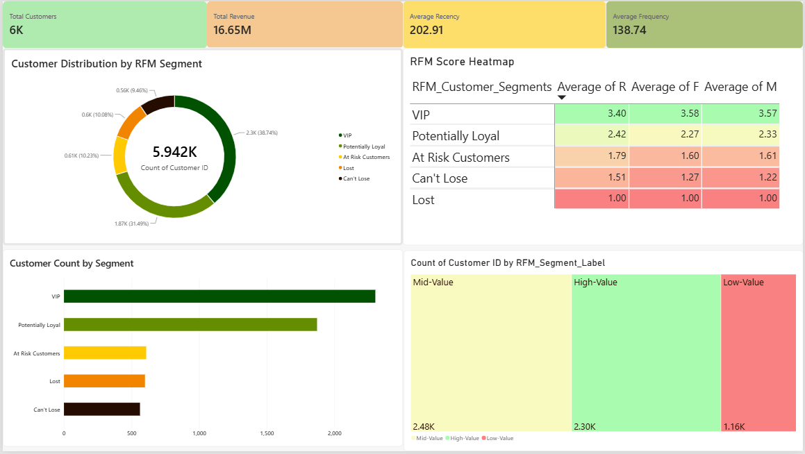

##  Power BI Dashboard

The interactive Power BI dashboard provides insights into customer behaviour and segmentation using the RFM (Recency, Frequency, Monetary) model.

### Dashboard Preview

### Dashboard Highlights

- **Customer Overview:** Total customers, revenue, average recency and purchase frequency.
- **Customer Segmentation:** Distribution across VIP, Potentially Loyal, At Risk, Lost and Can't Lose segments.
- **RFM Heatmap:** Comparison of Recency, Frequency and Monetary scores across customer segments.
- **Customer Value Analysis:** Classification of customers into High-Value, Mid-Value and Low-Value categories.
- **Customer Insights:** Visual comparison of customer counts and segment performance.

### Tools Used

Python | Pandas | NumPy | Plotly | Power BI | DAX

### Project Files

- `first.ipynb` – Python data cleaning, RFM calculations and exploratory analysis.
- `RFM_Customer_Analytics.pbix` – Power BI report.
- `images/dashboard.png` – Dashboard preview.
